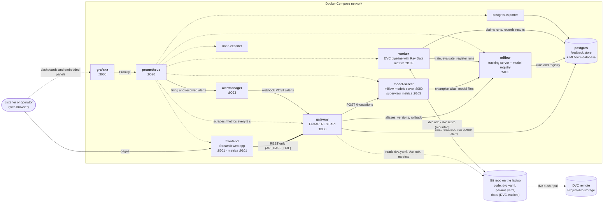
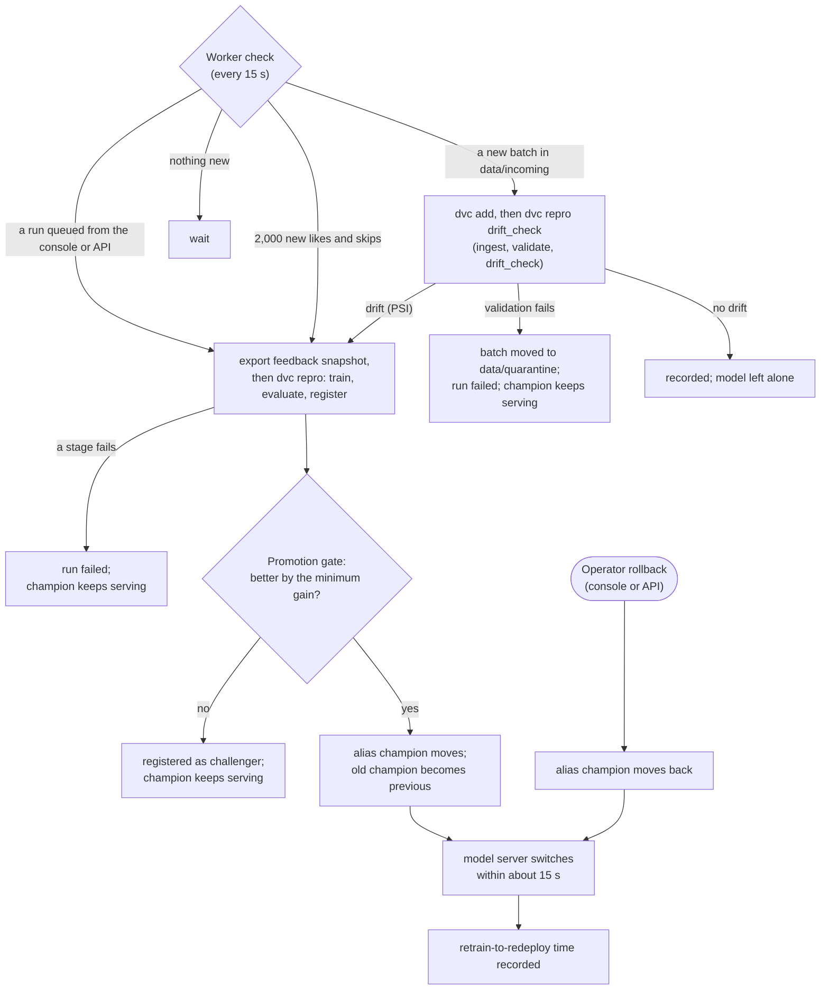

# Spatify architecture

Spatify recommends songs that sound like a song you pick, or like the sliders you set, with no listening history needed. It learns from likes and skips, notices when new songs differ from what it was trained on, and retrains, checks and redeploys its model by itself. This document shows every part of the system, how data and models flow through it, and what each block does. The reasons behind each choice are in the [high-level design](hld.md) and the [decision log](decision_log.md) (D1–D44); the interfaces in detail are in the [low-level design](lld.md).

Everything runs on one laptop as 11 Docker Compose services, started with `docker compose up -d --build`. Every port is published on `127.0.0.1` only.

## 1. Components and connections

Thick arrow: the only way from the user-facing app to the backend. Solid arrows: requests. Dashed arrows: reads, scrapes and links.

## 2. Data and model flow

How a song in the raw dataset becomes a recommendation, and how listeners' reactions come back to train the next model. Each box in the middle row is a DVC stage (`dvc.yaml`); `dvc repro` runs only the stages whose inputs changed.

```mermaid
flowchart LR
    raw[("Spotify tracks CSV<br/>(dvc import-url)")] --> make_batches["make_batches"]
    make_batches --> base[("data/base<br/>80% of tracks")]
    make_batches --> batches[("data/batches<br/>normal, shifted, drifted")]
    batches -.->|"an operator drops a file"| incoming[("data/incoming")]

    base --> ingest["ingest<br/>(Ray Data)"]
    incoming --> ingest
    ingest --> validate["validate<br/>(Ray Data)"]
    validate -->|"bad rows rejected;<br/>> 5% in a file stops the run"| features["features<br/>(Ray Data)"]
    validate --> drift["drift_check<br/>PSI and KS"]
    features --> train["train<br/>6–7 candidates"]
    snapshot[("data/feedback<br/>likes and skips")] --> train
    train --> evaluate["evaluate"]
    evaluate --> register["register<br/>promotion gate"]
    register --> registry[("MLflow registry<br/>champion · previous · challenger")]

    registry -->|"champion"| serving["model-server"]
    serving --> gw["gateway"]
    gw --> app["frontend"]
    app -->|"likes and skips"| gw
    gw --> store[("postgres<br/>feedback table")]
    store -->|"exported before each retrain"| snapshot
```

## 3. The automation loops

The worker checks every 15 seconds for something to do. Every path ends either with the champion unchanged or with a better model serving.

Alerts run alongside: Prometheus evaluates 8 alert rules every 5 seconds (a service down, slow or failing recommendations, data drift, falling like rate, a failed pipeline run, low memory) and Alertmanager delivers firing and resolved alerts to the console through the gateway.

## 4. The blocks

### Services in Docker Compose

| Block | What it does | Built with | Talks to | Port (localhost) | State | Memory limit |
|---|---|---|---|---|---|---|
| **frontend** | The web app: *Discover* (pick a song or set sliders, get recommendations, like or skip), the *Operator console* (pipeline, models and rollback, data drift, alerts, live charts, links), *Help* | Streamlit | the gateway only, over REST | 8501; metrics 9101 | none (the admin key stays in the browser session) | 512 MB |
| **gateway** | The single REST API: recommendations, feedback, search, model versions and rollback, pipeline runs, drift, alerts, health. Saves every served list and every like or skip with the model version that produced it. Adds "why" labels and one random "wildcard" per list. | FastAPI | model server, MLflow, Postgres; reads the pipeline files | 8000 (API docs at `/docs`) | none of its own | 512 MB |
| **model-server** | Serves the registry's `champion` model. A supervisor reads the alias every 10 s and restarts `mlflow models serve` on the new version when it moves (promotion or rollback). | MLflow pyfunc, a Python supervisor | MLflow | internal 8080; metrics 9103 | the model, loaded from MLflow | 768 MB |
| **mlflow** | Experiment tracking (every pipeline run, its parameters, metrics, plots and lineage) and the model registry (versions and the `champion`, `previous` and `challenger` aliases). Serves model files to the model server and the gateway. | MLflow server | Postgres | 5000 | runs in Postgres; files in the `mlflow-artifacts` volume | 768 MB |
| **postgres** | The feedback store (served lists, likes and skips, pipeline runs, incoming batches, alerts) and MLflow's database. | PostgreSQL 17 | — | internal 5432 | `postgres-data` volume | 256 MB |
| **worker** | The automation: watches `data/incoming`, the run queue and the feedback count; runs the DVC pipeline (Ray Data for the data stages, MLflow Projects for the model stages); records each run and measures retrain-to-redeploy. | Python loop, DVC, Ray, MLflow | the repo (mounted), Postgres, MLflow, the model server | metrics 9102 | the repo's `data/`, `dvc.lock` | 3 GB (Ray capped at 4 CPUs, 1 GB) |
| **prometheus** | Scrapes every service's metrics every 5 s, keeps 2 days, evaluates recording and alert rules. | Prometheus 3.15 | every metrics endpoint; Alertmanager | 9090 | `prometheus-data` volume | 384 MB |
| **alertmanager** | Groups alerts and posts them, firing and resolved, to the gateway's `/alerts`. | Alertmanager 0.28 | the gateway | 9093 | `alertmanager-data` volume | 64 MB |
| **grafana** | Four provisioned dashboards (service health, model and feedback, data and pipeline, laptop and app load); anyone on the laptop can view them, and the console embeds six panels. | Grafana 12 | Prometheus | 3000 | `grafana-data` volume | 512 MB |
| **postgres-exporter** | Exposes Postgres's health, table row counts and database sizes as metrics. | postgres_exporter | Postgres | internal 9187 | none | 64 MB |
| **node-exporter** | Exposes the laptop's CPU, memory and disk as metrics (read-only view of the host). | node_exporter | — | internal 9100 | none | 64 MB |

### Outside Compose

| Block | What it does |
|---|---|
| **Git repository** | Code, `dvc.yaml` (the pipeline), `params.yaml` (every setting), `MLproject`, Dockerfiles, Compose, monitoring config, tests and documents. DVC-tracked data and pipeline outputs live under `data/` and `metrics/`; Git stores their `.dvc` and `dvc.lock` pointers. The worker works in this repo through a bind mount. |
| **DVC remote** (`Project/dvc-storage`) | A local folder (cloud platforms are not allowed) holding every version of the data and the feedback snapshots; `dvc push` and `dvc pull` move them. |
| **Developer tools** | `make ci` (lint, tests, `dvc repro` and the promotion gate), `make load-test`, `make failure-test`, the user simulator (`scripts/simulate_users.py`) and the bad-deployment demo (`scripts/force_bad_model.py`). |

### The DVC pipeline stages

| Stage | What it does | Output |
|---|---|---|
| `make_batches` | Splits the raw dataset into a base catalogue (80% of tracks) and test batches: normal, shifted (unseen genres) and drifted (shifted features), with planted bad rows. | `data/base`, `data/batches` |
| `ingest` | Reads the base catalogue and every file in `data/incoming` with Ray Data, every column as text, tagging each row with its source file. | `data/ingested`, rows per second |
| `validate` | Checks types, ranges and required columns row by row; rejects bad rows with a reason; stops the pipeline if any file has more than 5% bad rows. | `data/validated`, a reject report |
| `features` | Merges tracks listed under several genres, places the key on the circle of fifths, fits the scaler and writes the feature table. | `data/features` (tracks, scaler, drift reference) |
| `drift_check` | Compares each incoming batch with the training data, feature by feature: PSI decides (any feature ≥ 0.2, or two at 0.1–0.2), KS is reported. | `metrics/drift.json` |
| `train` | Builds 6 candidate models (3 feature sets × 2 weightings) and, given enough likes and skips, a 7th with weights learnt from them; logs each to MLflow. | candidate models in MLflow |
| `evaluate` | Scores every candidate: genre match on held-out songs and, once there is enough feedback, NDCG on held-out likes and skips. | `metrics/evaluate.json`, plots |
| `register` | Registers the best candidate and promotes it to champion only if it beats the current champion by the minimum gain. | a model version; `metrics/register.json` |
| `eda`, `python_env` | The exploratory data report; the MLproject environment file, generated from the lock file. | `reports/eda`, `python_env.yaml` |

## 5. How the parts work together

- **A recommendation.**
  1. The browser asks the frontend, and the frontend asks the gateway (`POST /recommend`).
  2. The gateway asks the model server, which scores all 64,000 songs against the query in a few milliseconds.
  3. The gateway puts one random "wildcard" in the last slot, adds the "why" labels, saves the list in Postgres with the model version, and answers.
- **A like or skip.** The frontend sends `POST /feedback` with the list's ID. The gateway checks the song was in that list and stores the rating with the version and position it was shown at.
- **New songs.**
  1. A batch dropped into `data/incoming` is validated and checked for drift within about 15 seconds.
  2. A drifted batch triggers a retrain. A bad batch is quarantined, and the champion keeps serving.
- **Learning from listeners.**
  1. After every 2,000 new ratings, the worker exports them to a DVC-versioned snapshot and retrains.
  2. A model whose feature weights are learnt from the ratings competes with the others at the promotion gate.
- **Promotion and rollback.**
  1. Only the register stage, or an operator's rollback, moves the `champion` alias.
  2. The model server follows the alias within about 15 seconds.
  3. Every list records which version made it, so like rates can be compared per version.
- **Monitoring.**
  1. Every component exposes metrics. Prometheus scrapes them every 5 seconds.
  2. Grafana shows them; the alert rules fire through Alertmanager into the console.
  3. The console's Monitoring tab shows the alerts next to live Grafana panels.
- **Traceability.** Every model version in MLflow is tagged with:
  - the git commit and the DVC data version it was trained on;
  - what triggered its run;
  - its run's metrics, plots and the feedback snapshot it learnt from.

## 6. Boundaries the design keeps

- **Loose coupling:** the frontend reaches the backend only through the gateway's REST API, at a configurable address (`API_BASE_URL`). Its image has no MLflow, database driver or model code.
- **One way to change the served model:** the registry's `champion` alias. The pipeline's gate and the operator's rollback are the only writers.
- **Failure leaves serving untouched:** a pipeline run that fails (bad data, a crashed stage) never moves the alias, so listeners keep their recommendations (checked by `make failure-test`).
- **Resources:** every container has a hard memory limit, and Ray is capped, so the whole stack fits beside a browser and an editor on a 15 GB laptop (about 2 GB idle).
