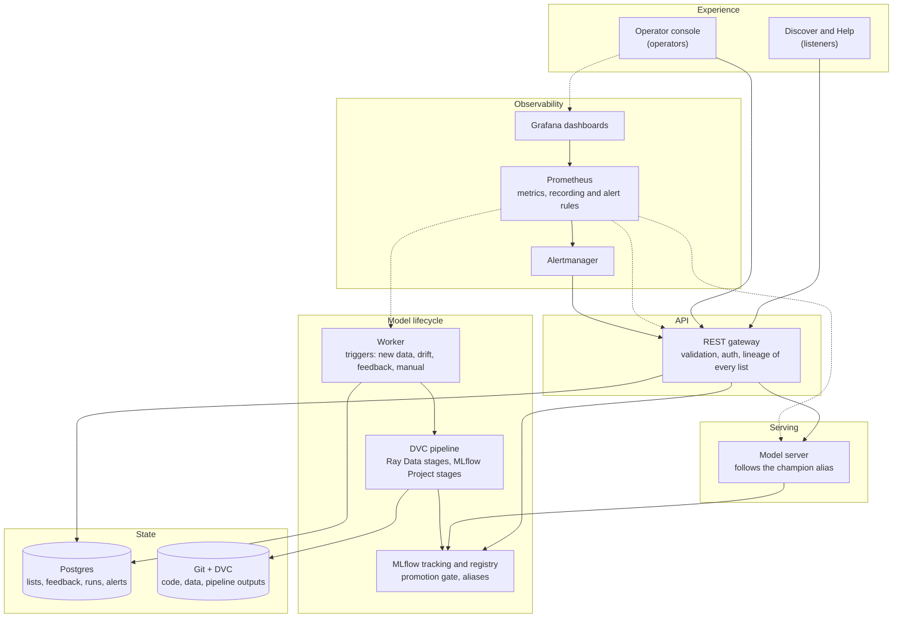

# Spatify high-level design

The design choices behind Spatify and the reasons for them. Each choice cites its entry in the [decision log](decision_log.md) (D1–D44), which records what else was considered and the measurements behind it. The system's parts are drawn in the [architecture](architecture.md); its interfaces are specified in the [low-level design](lld.md).

## 1. The problem and what the design must achieve

A new listener has no history, so history-based recommenders can't serve them: the cold-start problem. Spatify recommends from the songs' audio features alone (energy, valence, danceability, tempo and so on), starting from a song the listener picks or from sliders they set. The harder problem is operational. The model must take in new songs safely, learn from likes and skips, notice when its inputs change, retrain, check and redeploy itself, roll back when something goes wrong, and show all of this to the people who run it. The problem statement makes that lifecycle the main subject and keeps the model deliberately simple.

| Objective (problem statement) | How the design meets it |
|---|---|
| O1 Recommendation from audio features alone | Cosine nearest neighbours over weighted, standardised features (§3.4) |
| O2 Learning from feedback | Every like and skip stored with its list and model version; feature weights learnt from them (§3.9) |
| O3 Scalable data engineering on Ray | Ingest, validate and features as Ray Data stages (§3.3) |
| O4 Reproducibility: commit, data version, run ID | Git + DVC + MLflow lineage tags on every model (§3.2, §3.5) |
| O5 The workflow as a DVC pipeline | `dvc.yaml`, reproduced with one command; the worker runs it (§3.2, §3.7) |
| O6 Tracking and a registry with rollback | MLflow runs, versions and aliases (§3.5) |
| O7 Prometheus and Grafana in near real time | Every component instrumented; 5-second scrapes; four dashboards (§3.11) |
| O8 MLflow serving behind FastAPI; separate Compose services | Model server, gateway and frontend as separate services joined only by REST (§3.6) |
| O9 Usable by a non-technical user, plus an operator console | Discover, Help and the console (§3.10) |

## 2. Design overview

The principles that shape every choice below:

1. **Loose coupling over REST.** The frontend talks only to the gateway, at a configurable address. Serving, the registry and the database sit behind it, so each can change without touching the web app.
2. **Everything versioned.**
   - **Code** in Git.
   - **Data, pipeline outputs and feedback snapshots** in DVC.
   - **Models, their metrics and lineage** in MLflow.

   Any model can be traced to a commit, a data version and a run.
3. **One controlled path to production.** Only the promotion gate, or an operator's rollback, changes the model listeners get. Every failure path leaves the champion serving.
4. **Automation with a human override.** The worker retrains on new data, drift and feedback without being asked. An operator can start a run or roll back from the console at any time.
5. **Observable by default.** Every component exports metrics, the alerts reach the console, and every run, list and rating is recorded.
6. **Fits the machine.** A 15 GB laptop shared with a browser and an editor sets hard memory limits on everything (D30).

## 3. Design choices and rationale

### 3.1 Environment and repository

- **uv and one lock file** (D2): `uv.lock` pins every package with hashes. The same lock builds the local environment, every Docker image (D27) and the MLproject environment. Conda's exported file has no hashes and would be a second source of truth.
- **Python 3.12** (D3): every dependency ships wheels for it, and it matches the slim base images.
- **One extra per service** (D4): each image installs only what it needs (`pipeline`, `serving`, `frontend`, `mlflow-server`, `worker`). Ray 2.59 and MLflow 3.17.1 are pinned to the versions the course's exercises used.
- **The repo on the NTFS course drive** (D1): it keeps the project next to the course material. The costs are handled explicitly: file modes off in Git, uv copying instead of hard-linking, and service data in Docker volumes. After a drive remount the containers and the venv must be recreated.

### 3.2 Data, versioning and reproducibility

- **The dataset** (D5): the Spotify Tracks Dataset, imported from its author's Hugging Face copy with `dvc import-url`. Anyone can rebuild the data from the source without a Kaggle token.
- **DVC for data and models, Git LFS for binary documents** (D6): data and pipeline outputs change with the pipeline, so DVC versions them with `dvc.lock`. Screenshots and PDFs belong to the history, so they go in LFS.
- **A local DVC remote** (D7): cloud platforms are not allowed. The folder sits next to the repo, so a clone placed beside it can `dvc pull`.
- **Generated test batches** (D8):
  - **Split:** the dataset is split by track into a base catalogue and batches, so no song appears in both.
  - **Batch kinds:** normal batches test the no-drift case; shifted batches (10 genres held out) test a change in the genre mix; drifted batches (added energy and loudness) stand in for an "era" change, since there is no release year.
  - **Planted bad rows:** every batch has them, so validation can be checked against a known count.
- **Every batch versioned** (D13): `data/incoming` is DVC-tracked, so every model traces to the exact batches it saw.
- **Reruns give identical hashes** (D31): Ray writes files under random names and adds partial sums in any order. Both are pinned (named files, rounded scaler statistics), so identical data always gets the same DVC hash, and DVC doesn't retrain after a rerun that changed nothing.

### 3.3 The data pipeline on Ray

- **Read as text, type in validation** (D9): one malformed value can't fail a whole file. The bad row reaches validation and is rejected with its reason, and every row keeps the name of the file it came from.
- **Reject, warn or stop** (D10):
  - **Reject:** rows with missing, non-numeric or out-of-range values (the reason recorded).
  - **Warn but keep:** real but unusual rows, such as silent "sleep" tracks with zero tempo.
  - **Stop the pipeline:** a missing column, or any file with more than 5% of its rows rejected. The limit is per file, so a bad batch can't hide inside the 80,000-row catalogue. This follows the Great Expectations pattern from the course.
- **One row per track** (D11): 16,299 tracks are listed under several genres with identical audio. They are merged, keeping every genre, so a song can't be recommended twice. The merge hash-partitions by track, one call per block rather than one per track.
- **Features** (D12): the nine audio features, the mode, and the key placed on the circle of fifths, so musically related keys sit close together. Scaled with Ray's `StandardScaler`, whose statistics travel inside the model, so serving scales a query exactly as training did.
- **Ray, though pandas is faster at this size** (D14): measured, Ray overtakes single-process pandas between 0.8 and 1.6 million rows. The course requires Ray or Spark, and the same code scales out to a cluster unchanged.
- **Capped Ray** (D15, D30): 4 CPUs and a 1 GB object store, started fresh per stage. A Ray feature that rebuilds environments under `uv run` is turned off, because it broke the workers.

### 3.4 The recommender

- **Exact cosine nearest neighbours over weighted z-scores** (D16): with 64,000 songs and 12 features, one matrix product scores a query exactly in a few milliseconds. An approximate index would add a dependency for nothing. Repeats of a song (album and single versions) are skipped.
- **Evaluation before feedback exists** (D17): genre match@10 on held-out seed songs, a proxy for "sounds alike". The best candidate reaches 13.5% against 1.5% for random songs. That's low in absolute terms: audio features alone separate genres weakly, which is the cold-start limit feedback is meant to improve on.
- **Six candidates per training run** (D18): three feature sets (all, without key and mode, without loudness) times two weightings (uniform, or Fisher: between-genre over within-genre variance). Dropping a feature group per run measures its importance.
- **Sliders** (D19): unset sliders sit at the average (z = 0), so they add nothing to the query. The median would have pulled results toward major keys.
- **Packaging** (D20): one MLflow pyfunc model carries its catalogue, scaler, weights and code, with an explicit signature (every input optional, K as a parameter). It answers with its training run's ID, so every list can be traced to a model.

### 3.5 Experiment tracking, MLproject and the registry

- **Model stages as MLflow Projects** (D21): DVC runs `mlflow run` for train, evaluate and register, using `python_env.yaml`, which is generated from the lock. Each run logs more than autolog would:
  - the git commit and whether the tree was dirty;
  - the DVC data version and what triggered the run;
  - the environment and the data-quality metrics;
  - the feature weights and their plots;
  - the drift reference sample.
- **The promotion gate and aliases** (D22):
  - The best candidate is registered as the `challenger`.
  - It is promoted to `champion` only if it beats the current champion by 0.005 on the same held-out seeds. That's two standard errors, so noise doesn't churn the model that feedback is attributed to.
  - The old champion becomes `previous`, the rollback target.
  - Not promoting is a normal outcome, not a failure. Aliases rather than stages, which are deprecated.
- **The tracking server** (D25): runs and the registry in Postgres. Model files are served by the MLflow server, so every client needs only HTTP, not a shared disk.

### 3.6 Serving

- **Separate services** (D23): Postgres, MLflow, the model server and the gateway, joined by service names. Each has health checks and a start order. Secrets are in a git-ignored `.env`.
- **A model server that follows the alias** (D24):
  - **Why it's needed:** `mlflow models serve` resolves an alias once, at start-up, so a promotion would never reach it.
  - **What it does:** a small supervisor reads the alias every 10 s and restarts the server on the new version. It also restarts a crashed server, and keeps serving if MLflow is down.
  - **The cost:** a switch leaves about 5 s with no server, during which the gateway answers 503 "try again". Blue-green serving would remove that gap, at the price of more moving parts.
- **The gateway** (D26):
  - **Its role:** the frontend's only door, built with FastAPI and Pydantic. Bad input gets a 422 naming the field.
  - **Every served list is stored** with its model version, and feedback must refer to a stored list. So each rating carries the version and position it was shown at, and ratings on songs that weren't shown are refused.
  - **`/health`** reports 503 until recommendations can actually be served.
- **Images** (D27): multi-stage builds from the same lock, slim final stage, non-root user, an allow-listed build context.
- **Admin actions need a key** (D28): rollback and starting a run need the admin key. The gateway holds only its SHA-256 hash.

### 3.7 Automation: the worker and its triggers

- **A run queue in Postgres** (D29): the console's "run now" inserts a row; the worker claims it. A request survives a worker restart, and the console's run history reads the same table.
- **The worker** (D36): a loop every 15 s, in this order:
  1. **A queued run:** retrain.
  2. **New or changed batches:** validate and check drift; retrain only if a batch drifted.
  3. **2,000 new ratings:** retrain (D37).

  It records every run and stage in Postgres. A failure never moves the champion:
  - a bad batch is quarantined;
  - a failed run isn't retried at full speed;
  - a run interrupted by a restart is marked failed.

  It runs the repo's own code, so the stages are exactly what DVC hashed. It leaves `dvc.lock` for the operator to commit, rather than committing from a container.

### 3.8 Drift

- **PSI decides, KS reports** (D35):
  - **The comparison:** each batch against the training data, feature by feature.
  - **The rule:** a batch has drifted if any feature's PSI is 0.2 or more, or two are between 0.1 and 0.2. Calibrated on the generated batches: normal batches peak at 0.012; shifted batches reach 0.21 with two or three moderate features.
  - **Why KS doesn't decide:** against 80,000 reference rows, KS calls even normal batches different, so its p-values mostly measure sample size.
  - **Where the scores go:** DVC metrics, the console, and Prometheus gauges (FR4).

### 3.9 Learning from feedback

- **Feature weights from a logistic regression** (D37):
  - **How:** a like is predicted from how close the song is to the query, feature by feature. Features where closeness raises the chance of a like get more weight.
  - **Why this kind of model:** the served model stays one simple model whose weights explain themselves. A separate re-ranker would mean two models to version together, and collaborative filtering needs histories that cold-start listeners don't have.
  - **The gate:** once there are 30 held-out lists, the candidates are judged on NDCG@3 over held-out likes and skips.
  - **What happened:** the first feedback model wasn't promoted, because the held-out lists were the champion's own picks, which favours it. The second, with more ratings, was promoted (version 8). That bias is recorded as a known limit; a live A/B test of like rates would remove it.
- **Exploration** (D37): one slot in ten is a random "wildcard". Without it, feedback covers only songs the model already ranks high, the hidden feedback loop from the course's technical-debt lecture.
- **Feedback drift** (D37): a like rate 15 points below the one before it raises an alert, but doesn't retrain. After a promotion, a falling like rate more likely means a bad model, which an operator should roll back.
- **Simulated listeners** (D38):
  - **Why:** real listeners are few, as the problem statement anticipates.
  - **What the system sees:** each simulated listener has a hidden taste over five features and likes songs close to it, with noise. The system never sees that taste; it has to learn it.
  - **Calibration:** cold-start picks are liked about 40% of the time.
  - **Stated plainly:** the results show the loop works, not what real listeners would gain.
- **A forced bad deployment** (D39): a script makes a broken copy of the champion (audio features shuffled between songs) the champion, skipping the gate. The like rate collapses, feedback drift fires, and an operator rolls back: the problem statement's rollback test. It is a script, not a console button, because a "deploy a broken model" button has no place in an operator console.

### 3.10 The web app

- **Streamlit, talking only to the gateway** (D32):
  - **Discover:** search for a song, or switch sliders on; the button stays disabled until there's something to search with. Each result shows its similarity, why it was picked, and Like and Skip buttons that can't be pressed twice.
  - **Every failure becomes a plain message** saying what to do, never a stack trace.
  - **The admin key** stays in the operator's browser session, not in the frontend's container.
  - **Charts** follow the course's "7 commandments".
- **"Why" labels that are exact** (D33): a cosine score is a sum over features, so each feature's share of it is exact. The labels name the largest shares ("energetic", "acoustic"). The gateway computes them with the answering model's own scaler and weights, and gives none rather than wrong ones if a different model answered.
- **The pipeline view from DVC's own files** (D34): the console's pipeline diagram is built from `dvc.yaml`, `dvc.lock` and the metrics files, coloured by the last run's results, so it matches `dvc dag` without putting DVC in the gateway.

### 3.11 Monitoring and alerting

- **Prometheus scrapes every component** (D40):
  - **Directly:** the gateway, frontend, worker, MLflow (`--expose-prometheus`) and the model server's supervisor.
  - **Through exporters:** Postgres, and the laptop itself.
  - **Fixes made along the way:**
    - The supervisor exports the server's side, because `mlflow models serve` has no metrics endpoint.
    - The worker exports Ray Data throughput per stage.
    - The frontend starts its metrics server with the process, not on the first page view.
- **Alerts** (D41):
  - **Rules:** recording rules for p95 latency, the error share and the like rate per version, and eight alert rules, each unit-tested with promtool.
  - **Delivery:** Alertmanager delivers to the gateway, so alerts appear in the console. The course's sample posts to an outside service instead.
  - **Alerts don't act:** the worker already retrains on drift, and a falling like rate is for a person to judge.
  - **Counters start at zero,** so a first failure isn't missed.
- **Dashboards** (D42):
  - **Four dashboards, 56 panels,** generated from one Python specification. So the course's 7 commandments hold everywhere: colour-blind-safe colours, line styles, named axes with units, legends, titles and descriptions.
  - **Tested:** a test checks every query names a metric something exports.
  - **Viewing:** anonymous and read-only, with six panels embedded in the console.

### 3.12 Resources

- **A memory budget** (D30): every service has a hard limit with no swap, at 1.5–2 times its measured use. Ray is capped, MLflow's unused job runner is off, and the model server runs one worker. The stack went from 2.4 GB to under 1.2 GB before monitoring, about 2 GB with it. A full pipeline run adds at most 2 GB.

### 3.13 Testing and continuous integration

- **Seven levels of tests and one command** (D43):
  - **Unit, component and integration tests** (172, about a minute) run on every change, including the whole pipeline into a throwaway registry.
  - **Stack tests:** the load test (p95 33 ms at 1 client, 160 ms at 10), the failure test (a stage killed mid-run, the champion keeps serving) and the usability test.
  - **`make ci`:** lint, tests, then `dvc repro` and the gate's decision. CI runs through DVC rather than a cloud service, which the course disallows.
  - **Acceptance criteria** come from the problem statement's requirements ([test plan](test_plan.md), [test report](test_report.md)).

### 3.14 Security

- **Hashed keys, no secrets in logs, localhost only** (D44):
  - **Secrets:** generated randomly into a `0600`, git-ignored file. The gateway checks the admin key against its hash in constant time, and a test proves no key reaches the logs.
  - **Containers:** non-root processes, every port on `127.0.0.1`.
  - **Encryption:** used where it does something (the stored key is a hash). It isn't added for traffic that never leaves the laptop, nor for public data at rest. The [security note](security.md) lists what would change first if Spatify left the laptop.

## 4. The AI lifecycle in this design

How the design covers each stage of the course's [development guidelines](course/AI%20Application%20Development%20Guidelines.pdf).

| Guideline stage | In Spatify |
|---|---|
| A. Problem definition and data collection | Problem and success measures (§1); dataset, licence and biases in [data.md](data.md); EDA report (`reports/eda/`); versioned ingestion and validation (D5, D9, D10) |
| B. Preprocessing and feature engineering | Automated `validate` and `features` stages on Ray (D10–D12); feature importance by dropping feature groups (D18) |
| C. Model development and training | Six candidates per run, tracked in MLflow with lineage beyond autolog; MLproject environments (D16–D21) |
| D. Deployment | Online serving through the registry's champion, a CI pipeline through DVC with a promotion gate, rollback by alias (D22–D24) |
| E. Monitoring and maintenance | Drift on data and feedback, automated retraining, Prometheus and Grafana with alerts (D35–D42) |
| Core principles | Automation (the worker); reproducibility (Git + DVC + MLflow); CI (`make ci`, DVC); monitoring and logging (Prometheus, JSON logs); version control of code, data and models; environment parity (one lock, Docker Compose) |

## 5. Requirements traceability

| Requirement | Where it is met | Evidence |
|---|---|---|
| FR1: recommendations from a seed or sliders | Recommender (D16, D19), gateway `/recommend`, Discover | Test report AC-01 |
| FR2: feedback stored with time and model version | Gateway stores every list and rating (D26) | AC-02 |
| FR3: ingest and validate new batches | Ray stages, reject/warn/stop policy, quarantine (D9, D10, D36) | AC-03 |
| FR4: drift scores as metrics | `drift_check`, Prometheus gauges, the console (D35) | AC-04 |
| FR5: retrain on drift or feedback; promote only if better | Worker triggers, promotion gate (D22, D36, D37) | AC-05 |
| FR6: operator console with history, model, drift, rollback | Console tabs (D32–D34, D41) | AC-06 |
| Performance: p95 in the low hundreds of milliseconds | Exact scoring in milliseconds (D16) | AC-07: 33 ms at 1 client, 160 ms at 10 |
| Reliability: failed runs don't disrupt serving | Only the gate moves the alias (D22, D36) | AC-08: failure test PASS |
| Reproducibility | Git + DVC + MLflow; deterministic outputs (D21, D31) | AC-09: the reproducibility drill |
| Observability | Every component instrumented (D40–D42) | AC-10 |
| Portability: one `docker compose up` | 11 Compose services (D23) | AC-11 |
| Usability: a first-time user in about 30 s | Discover's design (D32) | AC-12 |
| Maintainability | Ruff, 172 tests, 84% coverage, inline documentation, documents checked against the code (D43) | AC-13 |

## 6. Limits and what would come next

- **Simulated feedback.** Learning from feedback is shown with simulated listeners (D38). With real users, the hidden-taste results would need re-measuring.
- **The gate's bias.** Held-out lists are the champion's own picks, which favours it (D37). Serving the challenger to a share of traffic and comparing live like rates (a canary, using the `challenger` alias) would remove the bias.
- **Drift reference.** New batches are always compared with the base catalogue, so a batch like one already trained on is flagged again (D35). Re-baselining on each champion's training data would fix that.
- **One machine.** Throughput levels off at about 110 requests per second with one gateway process and one model-server process (test report §3). More processes, or Kubernetes Deployments with replicas, would scale it out. The Compose services map directly onto them.
- **A 5-second switch gap.** Blue-green serving would remove the brief 503s during a promotion or rollback (D24).
- **Security beyond the laptop.** TLS, disk encryption, a secrets manager and real user accounts (D44).
- **First-time use is too slow.** Three first-time users took about three minutes to their first recommendations, against the target of about 30 seconds. The likely causes are in the Discover page's layout (the button out of sight, two steps to pick a song); the [test report](test_report.md) (§5) gives the fix to make and test again.

## 7. Where the decisions came from

The decision log records each choice as it was made, with the alternatives and the measurements. AI assistance in drafting code and documents (including this one) is declared in [AI_DISCLOSURE.md](../AI_DISCLOSURE.md), as the course's fair-use code requires.
